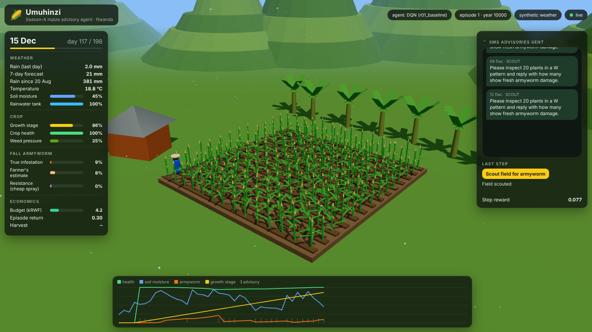

# Umuhinzi — an RL advisory agent for Rwandan smallholder maize



*Umuhinzi* means "farmer" in Kinyarwanda. This project trains reinforcement-learning agents to act as an **early-detection advisory system** for a smallholder maize plot during Rwanda's Season A (Sept–Feb). Every 3 days, a realistic SMS cadence, the agent decides which advisory to send the farmer: wait, plant, irrigate, spray, scout for fall armyworm, weed/top-dress, or harvest.

It compares one value-based method (**DQN**) with three policy-gradient methods (**REINFORCE, PPO, A2C**). All four are implemented with **TorchRL** and trained on the same custom Gymnasium environment.

It is part of my capstone mission: helping Rwandan farmers raise yearly yields by timing planting around climate shifts and using pesticides effectively.

---

## Quick start (uv only)

```bash
git clone <this repo> && cd nshuti_shalom_silver_rl_summative
uv sync                      # creates .venv from uv.lock
uv run main.py               # opens the 3D simulation with the best trained agent
```

Other commands:

| Command | What it does |
|---|---|
| `uv run main.py play --algo ppo --episodes 2` | Run a specific agent in the 3D viewer (also `uv run play.py ...`) |
| `uv run main.py play --algo dqn --drought` | Stress test: the same agent with 40 % less rain |
| `uv run main.py play --algo threshold_farmer` | Rule-based baseline, for comparison |
| `uv run main.py train --algo dqn --run 3` | Train config #3 of `training/configs/dqn_sweep.json` |
| `uv run main.py sweep --algo all` | Run all 40 experiments (10 per algorithm) |
| `uv run main.py evaluate` | Best model of each algorithm vs baselines, normal + drought → `logs/final_comparison.csv` |
| `uv run main.py plots` | Report figures → `assets/figures/` |
| `uv run pytest` | Environment unit tests |

> On Linux, `uv sync` installs the default (CUDA) PyTorch wheel, which is a large download. Training runs on CPU.

---

## The environment (`environment/custom_env.py`)

One episode is one season on a 0.1 ha plot, from 20 August (before the rains) to early March. Each step is 3 days, so an episode lasts at most 66 steps. Money is in thousands of Rwandan francs (kRWF).

### Actions (Discrete(8)), each one a real advisory

| id | Action | Real-world meaning | Cost (kRWF) |
|---|---|---|---|
| 0 | `WAIT` | Monitor only, no SMS sent | 0 |
| 1 | `PLANT` | "Rains are established: plant maize now" | 12 |
| 2 | `IRRIGATE` | Water the plot from the household **rainwater tank** (+12 mm soil water, uses ⅓ tank; only possible if the tank holds enough) | 1.0 |
| 3 | `SPRAY_CHEAP` | Broad-spectrum pesticide (e.g. cypermethrin): 85 % kill × (1 − resistance); **builds resistance** | 2.5 + toxicity |
| 4 | `SPRAY_BIO` | Targeted/bio control (Bt, emamectin): 70 % kill, no resistance build-up | 6 + low toxicity |
| 5 | `SCOUT` | "Inspect 20 plants in a W pattern": returns the **true** infestation level | 0.3 |
| 6 | `WEED_FERTILIZE` | Weed + top-dress manure/urea | 4 |
| 7 | `HARVEST` | Harvest now (allowed from 75 % maturity); ends the episode | 2 |

An action that is invalid in the current state (e.g. spraying before planting) is a no-op with a −0.1 penalty.

### Observations (Box(18), all scaled to [0, 1]): provenance map

| # | Observation | Encoding / range | Real-world source | Cadence | In simulation |
|---|---|---|---|---|---|
| 0 | `day_of_season` | day / 198 | System clock | per step | step counter |
| 1 | `rain_last_step` | mm in last 3 days / 60 | Meteo Rwanda station / Open-Meteo API | daily | weather series |
| 2 | `forecast_rain_7d` | mm / 100 | 7-day forecast API | daily | true 7-day sum × log-normal error (σ = 0.35) |
| 3 | `cum_rain_since_start` | mm since 20 Aug / 400 | Weather API (onset detection) | daily | running sum |
| 4 | `soil_moisture` | fraction of a 70 mm root-zone bucket | Low-cost capacitive soil sensor | per step | water balance: rain − ET·Kc, drainage |
| 5 | `water_tank` | fraction of tank capacity (≈3 irrigations) | Tank level float sensor | per step | +1.5 % per mm of rain, −34 % per irrigation |
| 6 | `temperature` | (°C − 10) / 25 | Weather API | daily | weather series |
| 7 | `planted` | 0/1 | Farmer SMS confirmation | event | state flag |
| 8 | `crop_stage` | stage / 1.2 (1 = mature) | Days since planting + growing-degree model | per step | thermal-time growth |
| 9 | `crop_health` | 0–1 | Farmer report / photo | per step | 1 − cumulative water, pest, weed damage |
| 10 | `pest_estimate` | 0–1, **noisy, biased low** | Farmer's unprompted impression | per step | 0.6·true + N(0, 0.12) |
| 11 | `pest_scouted_last` | 0–1 | Farmer's scouting reply (SMS) | after `SCOUT` | true + N(0, 0.02) |
| 12 | `steps_since_scout` | steps / 10 | System log | per step | counter |
| 13 | `weed_pressure` | 0–1 | Farmer report | per step | logistic growth, faster when moist |
| 14 | `soil_fertility` | 0.6–1 | Soil test / input log | event | +0.12 per top-dress |
| 15 | `budget` | kRWF / 45 | Mobile-money / input log | per step | starts at 45 |
| 16 | `cheap_sprays_used` | count / 6 | System log | per step | counter (resistance proxy) |
| 17 | `days_since_spray` | days / 30 | System log | per step | counter |

**Hidden state** (simulated, not observed directly): true armyworm infestation, pest resistance to the cheap pesticide, and future weather.

### Dynamics
- **Weather:** daily rainfall and temperature. By default this comes from a synthetic generator calibrated to an approximate Northern Province bimodal climate, with random onset shifts, false onsets and mid-season dry spells. Each "weather year" is a seeded id: training uses ids 0–999 and **evaluation uses unseen ids 10 000–10 049**. Run `uv run python scripts/fetch_weather.py` to download real Open-Meteo data. The environment then replays real seasons, with ≤ 2015 for training and 2016+ held out.
- **Water:** rain-fed with a small rainwater-harvesting tank. The tank is nearly empty after the dry season, so the agent cannot "dry-plant and irrigate" in August. Water saved during the rains can rescue the crop in a mid-season dry spell.
- **Germination:** if the soil averages too dry over the first 6 days after planting, the seed can fail (the money is lost and the agent must replant).
- **Fall armyworm:** random moth arrivals plus temperature-driven logistic growth. Damage is highest in the whorl stage and negligible below 8 % infestation.
- **Water stress** hurts most around flowering. Weeds compete during the first 10 weeks. Grain left in the field after maturity deteriorates.

### Reward
`r = harvest_revenue − input_costs − toxicity + shaping − invalid − failure` (scaled to 1 unit = 10 kRWF)

- **Harvest:** 450 kg × health × maturity² × fertility factor × 0.35 kRWF/kg (delayed, at the end of the season).
- **Toxicity:** 0.6 per cheap spray, 0.1 per bio spray (health and environmental cost).
- **Failure:** −3 if the crop dies, nothing is planted, or the budget runs out before planting.
- **Shaping:** potential-based, `F = γΦ(s') − Φ(s)` with Φ = 0.5 × expected value of the standing crop (health × stage). This gives dense feedback on crop progress *without changing the optimal policy* (Ng, Harada & Russell, 1999).

**Start state:** 20 August, nothing planted, dry soil, budget 45 kRWF, random initial resistance and fertility, random weather year.

**Terminal conditions:** harvest, crop death (health ≤ 5 %), budget exhausted before planting, or end of season (forced harvest).

### Why RL (and not a classifier)?
Every decision changes future state, and its consequences arrive weeks later:
- Planting early risks losing the seed; planting late runs out of season.
- Cheap sprays work now but create resistance that weakens every later spray.
- Scouting costs a turn and money but reveals the hidden infestation (the problem is partially observable).
- Water used from the tank now is not available for a later dry spell, and money spent now cannot be spent later.

There is no "correct label" per day. Only the season's outcome tells you whether a sequence of advisories was good, which is exactly the credit-assignment problem RL solves.

### Rule-based baselines (`environment/baselines.py`)
- `random`: picks actions uniformly at random.
- `calendar_farmer`: plants on a fixed date and sprays the cheap pesticide every 2 weeks (common practice).
- `threshold_farmer`: extension-officer rules (plant after 50 mm of rain, scout weekly, spray above 20 % infestation, rotate products).

---

## Algorithms (TorchRL 0.15)

| Algorithm | File | TorchRL components |
|---|---|---|
| DQN | `training/dqn_training.py` | `QValueActor`, `EGreedyModule`, `DQNLoss` (double-DQN option), `TensorDictReplayBuffer`, `HardUpdate`/`SoftUpdate`, `Collector` |
| REINFORCE | `training/pg_training.py` | `ProbabilisticActor` + `OneHotCategorical`, `ReinforceLoss`, Monte-Carlo returns over complete episodes, optional value baseline |
| PPO | `training/pg_training.py` | `ClipPPOLoss`, `GAE`, `SamplerWithoutReplacement` mini-batches |
| A2C | `training/pg_training.py` | `A2CLoss`, `GAE`/n-step advantages, one update per rollout |

All four use the same environment (`training/common.py::make_env`), the same frame budget (300k), the same seeds and the same evaluation protocol. Evaluation runs the greedy policy on 50 **unseen** weather years in normal and drought (−40 % rain) conditions. Policy-gradient agents are also evaluated stochastically (`eval_sample_return_mean`).

### Hyperparameter sweeps
`training/configs/<algo>_sweep.json` holds 10 configurations per algorithm. Each changes one factor from the base config, so its effect can be attributed:

- **DQN:** learning rate, γ, replay size, batch size, target-update interval, soft vs hard target, double DQN, ε schedule.
- **PPO:** learning rate, clip ε, entropy coefficient, epochs, GAE λ, rollout length.
- **A2C:** learning rate, n-steps, entropy, value coefficient, GAE λ, advantage normalisation.
- **REINFORCE:** baseline, return normalisation, learning rate, γ, entropy, batch size, network width.

Outputs:
- `logs/<algo>/<run>/train.csv`: learning curves (return, loss, Q-values, entropy, KL, clip fraction).
- `logs/<algo>/sweep_summary.csv`: one row per run, hyperparameters plus final metrics.
- `models/{dqn,pg}/<algo>_<run>.pt` for every run, and `best_<algo>.pt` for the best run of each algorithm.

---

## Visualisation and integration (`environment/rendering.py`, `environment/web/`)

A **three.js** 3D scene, bundled locally so it works offline, renders the plot:
- maize plants grow, yellow and droop as health falls;
- armyworm larvae appear on infested plants, and weeds spread;
- rain falls and the soil colour follows soil moisture;
- spray and irrigation clouds appear, and the farmer walks the field;
- grain sacks appear at harvest.

A side panel shows the **SMS advisory** the farmer would receive at each step.

The Python environment streams each state to the browser as JSON over Server-Sent Events. The same server exposes a REST API, which is the serialisation path a real SMS or mobile back-end would use:

```bash
curl localhost:8765/api/spec                     # action + observation definitions
curl localhost:8765/api/state                    # latest farm state
curl -X POST localhost:8765/api/recommend -d '{"observation":[0.15,0.3,0.4,0.2,0.55,0.4,0.36,0,0,0,0,0,1,0,0.7,1,0,1]}'
# -> e.g. {"action_id": 1, "action": "PLANT", "advisory": "Plant maize"}
```

---

## Repository structure

```
├── pyproject.toml / uv.lock     uv-managed dependencies
├── main.py                      CLI: play | train | sweep | evaluate | plots | baselines
├── play.py                      3D demo with verbose terminal output
├── environment/
│   ├── custom_env.py            UmuhinziEnv (Gymnasium)
│   ├── weather.py               synthetic + historical weather
│   ├── baselines.py             rule-based farmer policies
│   ├── rendering.py             HTTP/SSE server + REST API
│   └── web/                     three.js front-end (vendored three r170)
├── training/
│   ├── common.py                env factory, evaluation, logging, checkpoints
│   ├── dqn_training.py          DQN
│   ├── pg_training.py           REINFORCE, PPO, A2C
│   └── configs/                 10-run sweep per algorithm
├── analysis/                    final evaluation + report figures
├── models/{dqn,pg}/             saved policies
├── logs/                        training curves + sweep summaries
├── assets/                      figures and screenshots for the report
├── scripts/fetch_weather.py     download real Open-Meteo weather
└── tests/                       pytest suite for the environment
```
